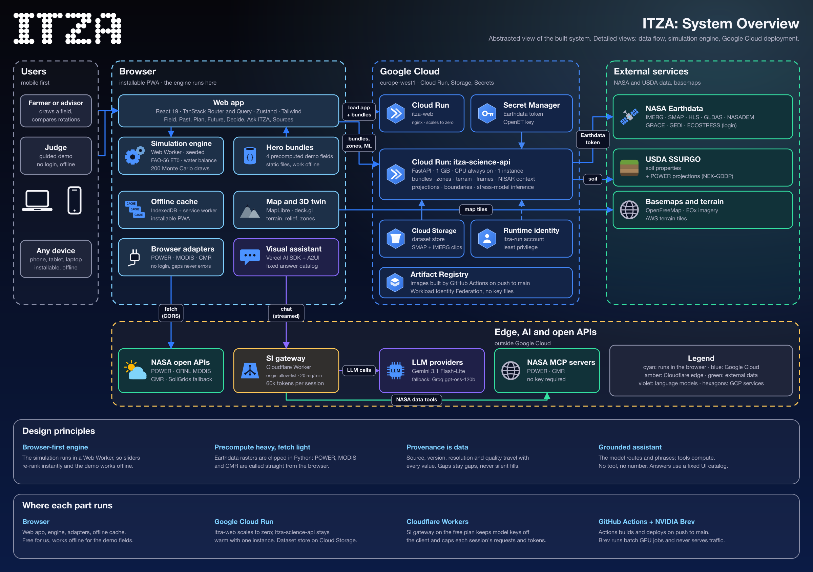
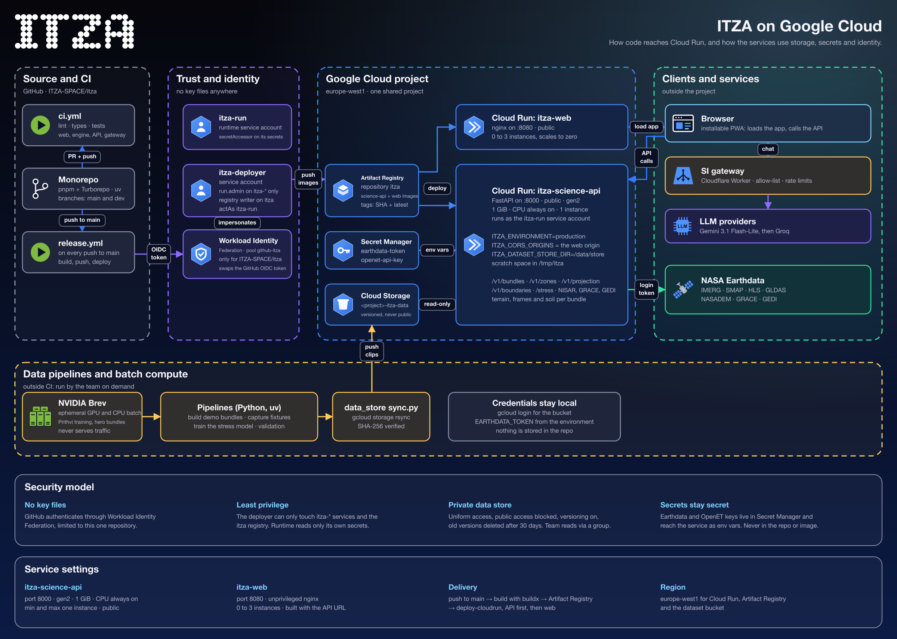

# Architecture

How the system is built: containers, data layer, simulation engine, ML, assistant, API. The four diagrams live in [Assets/diagrams](../Assets/diagrams).

[Back to the docs home](../README.md)

## Pages

- [Technical Architecture](TECHNICAL_ARCHITECTURE.md)
