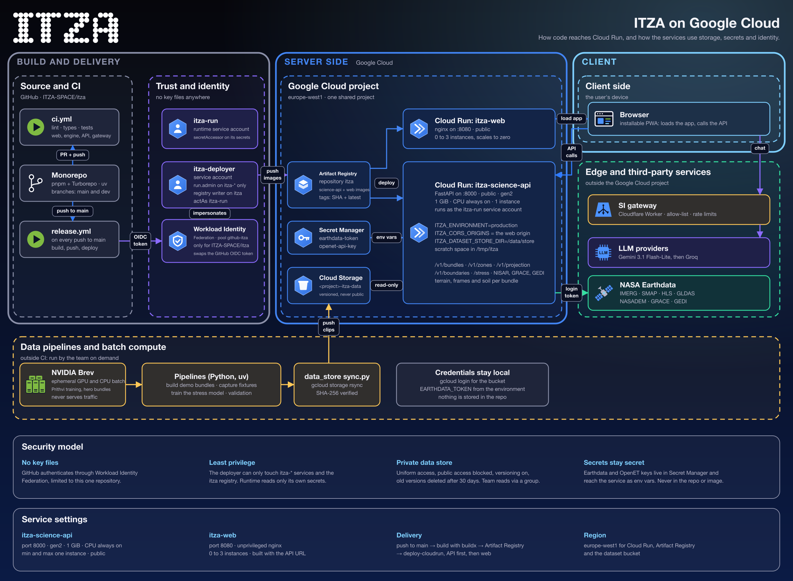

# Release to Cloud Run

Every push to `main` runs `.github/workflows/release.yml`. It builds two container images, pushes them to Artifact Registry and deploys two Cloud Run services in `europe-west1`: `itza-science-api` first, then `itza-web`.

## What the workflow does

1. **Authenticate without keys.** GitHub's OIDC token is exchanged through Workload Identity Federation for the `itza-deployer` service account.
2. **Build the API image** with `docker/build-push-action` and a GitHub Actions cache. Tags: the commit SHA and `latest`.
3. **Deploy `itza-science-api`** with `google-github-actions/deploy-cloudrun`. The deploy step carries the *whole* runtime configuration, so a rebuilt service reproduces the live one from the workflow alone (see the settings table below).
4. **Build the web image.** The build takes the API's deployed URL (`VITE_SCIENCE_API_URL`) and the gateway URL (`VITE_SI_GATEWAY_URL`) as build arguments, then serves the static build with unprivileged nginx on port 8080.
5. **Deploy `itza-web`** with 0 to 3 instances.

## Service settings

| Setting | `itza-science-api` | `itza-web` |
|---|---|---|
| Port | 8000 | 8080 |
| Memory | 1 GiB | default |
| CPU | always on (no throttling), so background jobs keep running | default |
| Instances | min 1, max 1 | min 0, max 3 |
| Execution environment | second generation | default |
| Access | public | public |
| Dataset store | Cloud Storage volume `dataset-store`, read-only at `/data/store` | none |
| Environment | `ITZA_ENVIRONMENT=production`, `ITZA_CORS_ORIGINS`, `ITZA_DATASET_STORE_DIR=/data/store`, `ITZA_DATA_DIR=/tmp/itza` | none |
| Secrets | `EARTHDATA_TOKEN` (`earthdata-token`), `OPENET_API_KEY` (`openet-api-key`) from Secret Manager | none |

## Identity, variables and settings

Every push to `main` runs `.github/workflows/release.yml`, which builds the images, pushes them to Artifact Registry and deploys two Cloud Run services in `europe-west1`: `itza-science-api` (port 8000) and `itza-web` (nginx, port 8080).

| Item | Value |
|---|---|
| GCP project | the shared project id in the repo variable `GCP_PROJECT_ID` |
| Image repo | Artifact Registry `itza` |
| Runtime identity | `itza-run@<project>` (add `secretAccessor` per secret when secrets are wired) |
| Deploy identity | `itza-deployer@<project>`: `run.admin` limited by IAM condition to services named `itza-*`, `artifactregistry.writer` on the `itza` repo, `serviceAccountUser` on `itza-run` |
| Auth from GitHub | Workload Identity Federation, pool `github-itza`, restricted to `ITZA-SPACE/itza`; no key files |
| Repo variables | `GCP_PROJECT_ID`, `GCP_REGION`, `GCP_WIF_PROVIDER`, `GCP_DEPLOYER_SA`, `GCP_RUNTIME_SA`, `WEB_ORIGIN` (CORS origin), `GCP_DATASET_BUCKET` (dataset store bucket, see below), `SI_GATEWAY_URL` (web build-time) |

The science API deploy step keeps the whole runtime configuration, so a rebuilt service reproduces the live one from the workflow alone: the second-generation environment, the read-only `dataset-store` volume (bucket from `GCP_DATASET_BUCKET`) mounted at `/data/store`, `ITZA_DATASET_STORE_DIR=/data/store`, and the Secret Manager secrets `EARTHDATA_TOKEN` (`earthdata-token`) and `OPENET_API_KEY` (`openet-api-key`), each readable by `itza-run`. Create a secret once with `gcloud secrets create <name> --data-file=-` and grant `itza-run` `roles/secretmanager.secretAccessor`; add a version to rotate it. If a deploy fails with a Secret Manager permission error for `itza-deployer`, grant that account `roles/secretmanager.viewer`. `SI_GATEWAY_URL` is a placeholder until the Cloudflare Worker is deployed.

## The assistant gateway is separate

The SI gateway is a Cloudflare Worker, not a Cloud Run service. It is deployed by hand with `pnpm --filter @itza/si-gateway deploy` (see [VPS and Cloudflare](04-vps-and-cloudflare.md)). Until it is deployed, `SI_GATEWAY_URL` is a placeholder.

## Related pages

[Hosting and compute](../01-System-Overview/03-hosting-and-compute.md) · [Dataset store](../03-Data/05-dataset-store.md) · [Security and privacy](../08-Quality/02-security-and-privacy.md)
