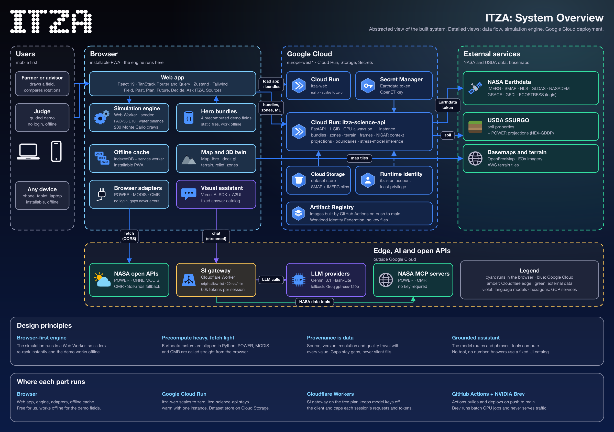
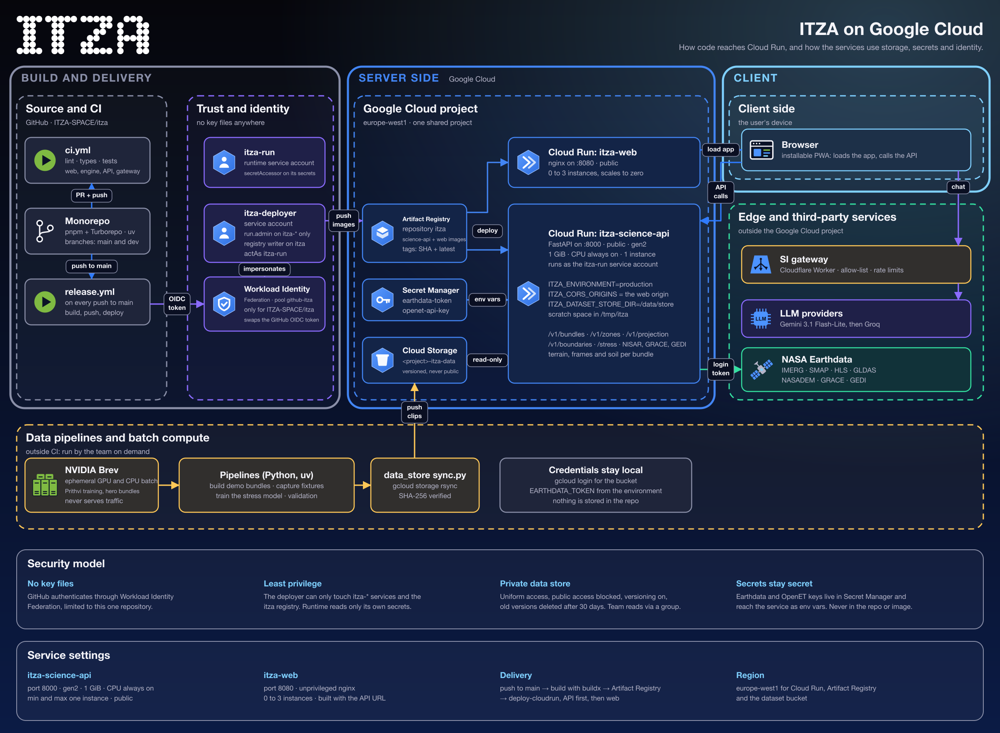
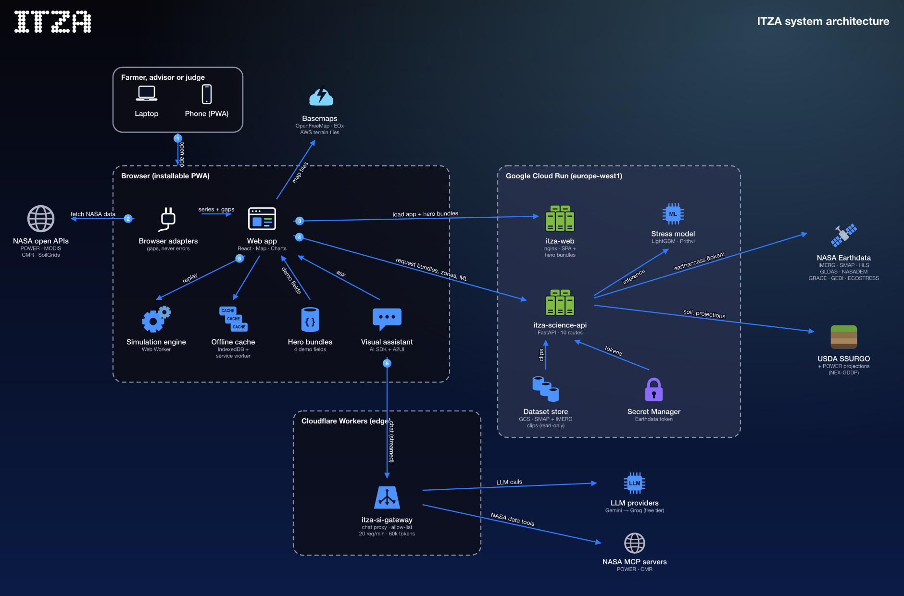
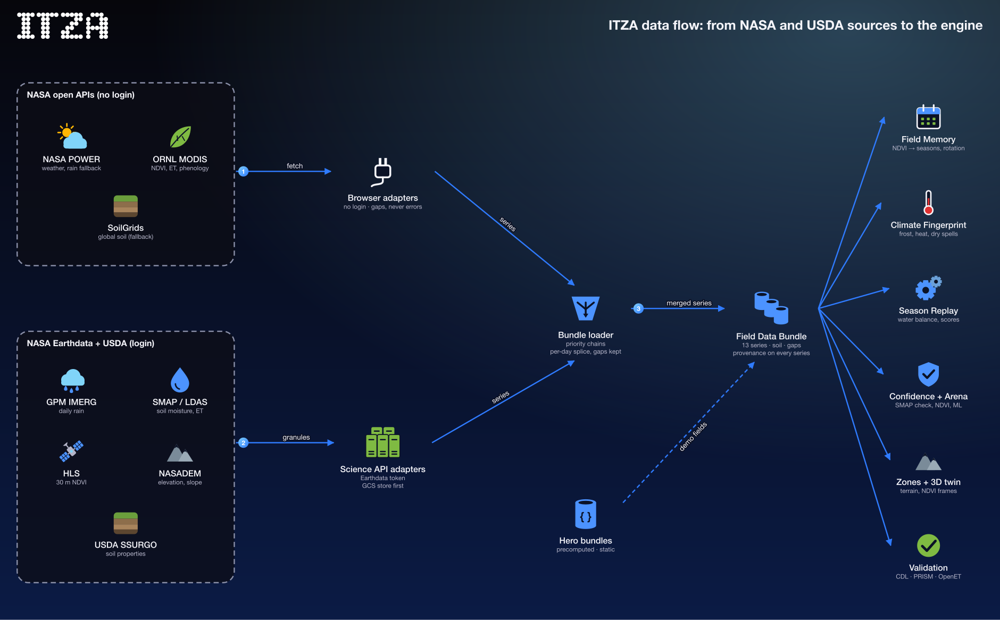
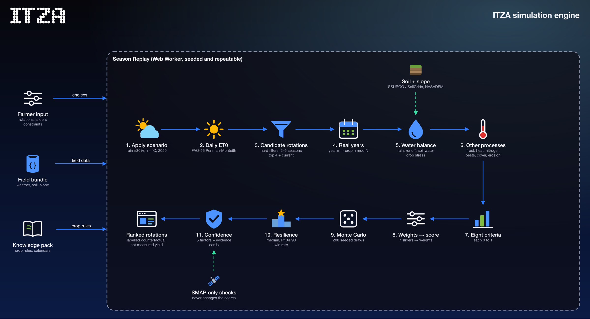
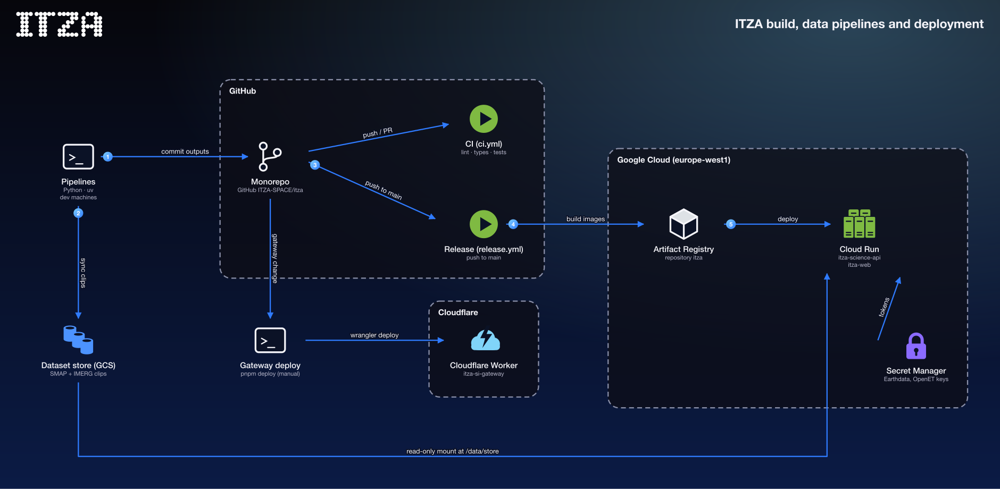

<div align="center">
  
</div>

# ITZA Documentation

Central documentation for **ITZA**, a web app that reads a field's history from NASA satellite data, replays every real past season (and plausible 2050 seasons) on candidate crop rotations, and shows which rotation would have held up best and why. Built for the NASA Space Apps Challenge 2026, "Field Shift: Adapting Farms with NASA Data".

Code lives in [`ITZA-SPACE/itza`](https://github.com/ITZA-SPACE/itza). **If a page and the code disagree, the code wins.**

## At a glance

### System overview

The whole system in one view: users, the browser (where the engine runs), Google Cloud, the Cloudflare edge, and the NASA and USDA services it depends on.



### Google Cloud deployment

How code reaches Cloud Run (GitHub Actions, Workload Identity Federation, Artifact Registry), and how the services use Cloud Storage, Secret Manager and service accounts.



### Detailed wiring

Component-level wiring of the same system, kept as a drill-down.



### Data flow

NASA and USDA sources are merged into one Field Data Bundle, with provenance on every series and gaps kept as gaps.



### Simulation engine

Eleven seeded, repeatable steps from scenario to ranked rotations. Output is a labelled counterfactual, not measured yield.



### Build and deploy



## Start here

| You are | Read this |
|---|---|
| A reviewer with 10 minutes | [Solution overview](01-Overview/SOLUTION_OVERVIEW.md), then [Features](01-Overview/FEATURES.md) |
| Checking how it is built | [Architecture](03-Architecture/00-README.md), then the [Engine](03-Architecture/02-Engine/01-overview.md) |
| Checking the science and data | [NASA data sources](05-Data-Sources/NASA_DATA_SOURCES.md) and the [dataset reports](05-Data-Sources/00-README.md) |
| Judging against the challenge | [Challenge rules](08-Challenge-and-Submission/CHALLENGE_RULES_2026.md), [Problem analysis](01-Overview/PROBLEM_ANALYSIS.md), [Demo strategy](02-Product/DEMO_STRATEGY.md) |
| Contributing | [Repository README](01-Overview/REPOSITORY_README.md), [AGENTS](09-Development/AGENTS.md) |

## Map

| # | Section | What is in it |
|---|---|---|
| 01 | [Overview](01-Overview/00-README.md) | Problem, solution, user journeys, features, repository README |
| 02 | [Product](02-Product/00-README.md) | PRD, MVP scope, demo strategy |
| 03 | [Architecture](03-Architecture/00-README.md) | The system split by subsystem: engine, data, front-end, back-end, AI, build and deploy, quality, decisions |
| 04 | [Components](04-Components/00-README.md) | One page per package and service: web app, engine, adapters, knowledge packs, UI kit, science API, assistant gateway, schemas, infra, pipelines |
| 05 | [Data sources](05-Data-Sources/00-README.md) | NASA and USDA catalogue, plus a report for each of 27 datasets |
| 06 | [Machine learning](06-Machine-Learning/00-README.md) | Stress model card |
| 07 | [Research](07-Research/00-README.md) | Background research, references, past winners comparison |
| 08 | [Challenge and submission](08-Challenge-and-Submission/00-README.md) | Challenge rules, project page, deck, video |
| 09 | [Development](09-Development/00-README.md) | AGENTS and CLAUDE guidance, fixtures, third-party notices |
| 10 | [Build log](10-Build-Log/00-README.md) | What we built and when: nine phases, and a feature-by-feature checklist |
| | [Assets](Assets) | Diagrams (PNG, SVG, generator source) and brand files |

Each section has a `00-README.md` index. Every page links back to its index.

## Diagrams

The six diagrams are generated from code. To rebuild them:

```bash
cd Assets/diagrams
node source/diagrams.mjs . && node source/overview.mjs .
for f in *.svg; do rsvg-convert -w 2400 "$f" -o "${f%.svg}-dark.png"; done
```

They follow the ITZA design system: Familjen Grotesk and DM Sans type, Rain `#7FD0FF` and Space `#2F7BFF` blues, glass panels on the dark void surface (dark mode only).
